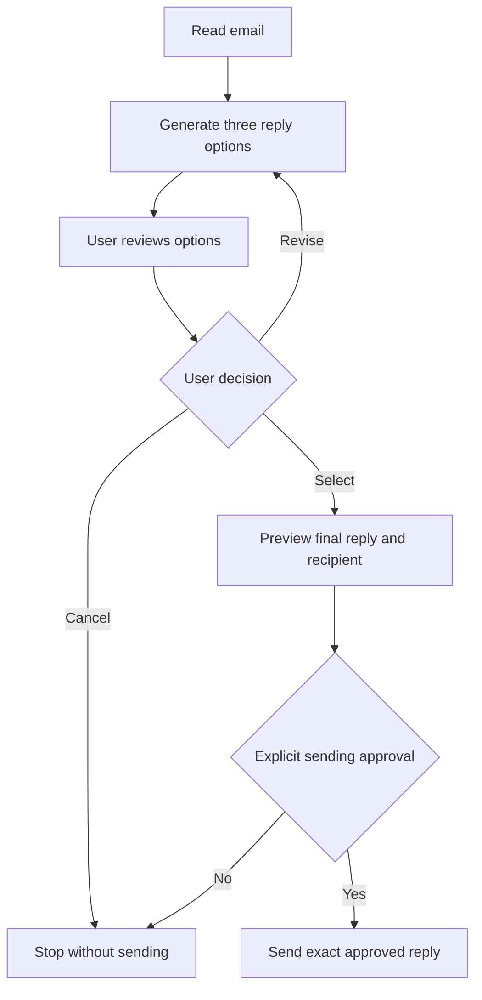

# Email Reply AI Agent

## Purpose
Read one email, generate three reply options, let the user choose or revise, and automatically send the exact approved reply. This is a runnable Python command-line prototype, not a hosted service.

## Quick start
Install Python 3.10 or newer. No third-party packages are required. Extract the ZIP, open a terminal in this folder, then run:

```bash
python agent.py --demo
python agent.py --check
```
On Windows, use `py` instead of `python` if needed. The demo uses a sample meeting email and three fixed drafts. It does not call AI or send email. Choose 1, 2, or 3 to preview, or C to cancel. `--check` reports whether an API key and mail settings are present, without printing secrets.

## Live setup
Use a mail account that permits authenticated IMAP and SMTP over TLS. This prototype uses a password or provider-issued app password; it does not implement OAuth. If your provider requires OAuth, this transport is not suitable without modification. Never put secrets in the source files or share them in the project ZIP.

The easiest way is to copy `.env.example` to `.env` in this folder and fill in your values; `agent.py` loads it automatically (`.env` is git-ignored). Variables already set in the terminal take precedence.

| Variable | Purpose |
|---|---|
| OPENAI_API_KEY | Your AI API key |
| OPENAI_MODEL | Chat model supporting JSON object output, default `gpt-4o-mini` |
| EMAIL_ADDRESS | Authenticated sender email address |
| EMAIL_PASSWORD | Email app password where supported |
| IMAP_HOST | Provider's IMAP server hostname |
| SMTP_HOST | Provider's SMTP hostname |
| SMTP_PORT | 465 (implicit TLS, default) or 587 (STARTTLS) |

Alternatively, set them in the terminal. PowerShell example, using placeholders:

```powershell
$env:OPENAI_API_KEY = "YOUR_API_KEY"
$env:OPENAI_MODEL = "YOUR_COMPATIBLE_MODEL"
$env:EMAIL_ADDRESS = "you@example.com"
$env:EMAIL_PASSWORD = "YOUR_APP_PASSWORD"
$env:IMAP_HOST = "YOUR_IMAP_HOST"
$env:SMTP_HOST = "YOUR_SMTP_SSL_HOST"
```

Use your provider's current documentation for hostnames and account access requirements. Environment variables last for this terminal session. API calls can incur usage charges, and the email text you submit is sent to the AI provider.

## Run with a real email
Export an email as a plain-text `.eml` file. First run preview-only mode:

```bash
python agent.py --eml sample.eml
```

Without `OPENAI_API_KEY`, this still works: it writes three local drafts from the facts you type. With a key, the same command asks the AI for the drafts. Nothing is sent unless you also pass `--send` and confirm the exact recipient.

Alternatively, list your 10 most recent INBOX emails with their UIDs, then reply to one:

```bash
python agent.py --list
python agent.py --uid 123
```

UID means the IMAP message UID, not its position in the inbox. Listing and fetching use read-only access and BODY.PEEK, so messages are not marked as read.

When ready to use live sending:

```bash
python agent.py --eml sample.eml --send
```

1. Review the incoming email.
2. Supply factual context, for example your actual availability.
3. Review three AI-generated options.
4. Select 1/2/3, type R to request revisions, or C to cancel.
5. Review the final sender, recipient, subject and body.
6. Type `SEND recipient@example.com` exactly as displayed.
7. The program sends that reply once, then stops.

Selection alone is not sending approval. Without `--send`, the app always stops at preview. If final confirmation does not match, it stops without sending. The default recipient is Reply-To, otherwise From; always check it. There is no reply-all, CC or BCC.

## Workflow


## Implementation
- `parse_email` reads plain text and validates the reply address.
- `read_mail` fetches one IMAP message with TLS.
- `generate` calls the AI API and validates that exactly three drafts were returned.
- The prompt treats the email as untrusted data and instructs the AI not to invent facts or control recipients. This reduces prompt-injection exposure, but model output still needs human review.
- `Reply` is immutable. Its SHA-256 digest covers sender, recipient, subject, body and reply reference.
- `deliver` rejects absent or mismatched approval before calling the transport. The CLI creates approval only after explicit confirmation. This is an in-process gate, not an authentication system or a tamper-proof security boundary against someone modifying the code.
- `smtp_send` uses SMTP over TLS and makes one send attempt. A positive SMTP response means server acceptance, not guaranteed inbox delivery.
- Replies include Message-ID and In-Reply-To/References for threading.

## Architecture terminology
This project implements the requested human-reviewed task as an AI-assisted workflow. Under Anthropic's stricter terminology, it is a workflow because program code controls the steps; the model drafts content rather than dynamically choosing tools. Calling it a fully autonomous agent would overstate its capabilities. A future agent could decide when to retrieve thread context or ask clarification, while retaining the approval gate.

## Verification
Run:
```bash
python -m unittest discover -v
```
Eight automated tests cover: missing approval, changed body or recipient, successful exact-message dispatch, invalid AI output, Reply-To selection, recipient header-injection rejection, display-name parsing, and local drafts when no API key is set. Tests use a mock transport and send no email. The sample demo has also been run through selection and cancellation.

Live AI generation, IMAP access and SMTP delivery were not tested during development because no credentials were provided and external service access is restricted in the build environment. Run locally with your own accounts, first in preview mode.

## Scope and limitations
- One email per run; manual start, no background monitoring or scheduling.
- CLI review rather than a web interface.
- No full-thread retrieval, attachment processing, HTML-only mail, OAuth or persistent session history.
- Email input is limited to 20,000 characters. Supply missing context manually.
- Maximum ten review rounds; cancellation and unexpected failures stop processing.
- No automatic retry after SMTP uncertainty. Check your mailbox or provider logs before restarting to avoid duplicates.
- No durable duplicate-send protection across separate runs, and no explicit Sent-folder upload. Whether sent mail appears there depends on the provider.
- Demo drafts are fixed. `--eml` without an API key revises local drafts from the text you type. AI revisions require `OPENAI_API_KEY`.

## Authentic sources
These sources ground the design and technical interfaces. The email flowchart is our adaptation, not an exact published diagram.

1. Anthropic, *Building effective agents* (December 19, 2024), sections “What are agents?” and “Agents”: human checkpoints, tools, environmental feedback, and workflow/agent distinction.
   https://www.anthropic.com/engineering/building-effective-agents
2. Python official documentation, `imaplib`: read-only mailbox selection and IMAP fetching.
   https://docs.python.org/3/library/imaplib.html
3. Python official documentation, `smtplib`: SMTP_SSL and sending messages.
   https://docs.python.org/3/library/smtplib.html
4. OpenAI official API reference: Chat Completions request and response format.
   https://developers.openai.com/api/reference/resources/chat

Sources checked October 12, 2026.
